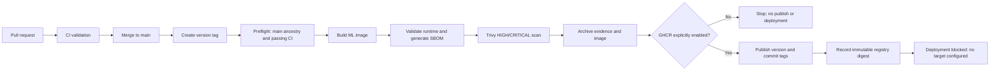

# Continuous Delivery Readiness

## Architecture assessment

The repository currently has one container build target: `services/ml-service/Dockerfile`. The Node.js services do not have Dockerfiles. `docker-compose.yml` configures a local development stack and is not a production deployment definition. No Kubernetes manifests, Helm chart, Terraform, AWS/EC2 deployment configuration, Nginx setup, production environment, or deployment target is configured.

The CI workflows are present on `main`. PR #33 was closed without merging; PR #34 merged the CI workflows in commit `2cb20c730e01313b15a9bd6b96863f26a64a4b1a`. The Node.js Validation, ML Python Tests, Docker Compose Validation, and Build ML Service Image checks all passed for that commit. The repository has no main-branch protection configured. Historical failures on the pre-CI commit are not failures of the current CI workflow.

The current GitHub token could not list organization container packages because it lacks `read:packages`. GHCR publishing authorization and an existing `ghcr.io/CONDUIT-FINTECH/conduit-ml-service` package therefore remain unverified. No image was published. The CD workflow keeps publishing disabled unless a repository administrator explicitly enables it after verifying organization/package access.

After the first successful CI run for this CD pull request, a repository administrator should configure a `main` branch ruleset/protection to require these exact checks:

- `Node.js Validation`
- `ML Python Tests`
- `Docker Compose Validation`
- `Build ML Service Image`

Branch protection is not changed by this implementation.

## Delivery flow



`.github/workflows/cd.yml` supports `v*` tag pushes and manual dispatch with an existing release tag. Preflight restricts releases to semantic version tags whose commit is reachable from `main`, checks the exact commit, verifies the ML build inputs, and requires successful latest results for all four CI checks. The workflow builds and scans locally, then retains SBOM, scan output, build metadata, and the image archive as workflow artifacts.

The scanner blocks HIGH and CRITICAL findings. A failed scan fails the build-and-scan job and prevents publication. No workflow deploys to production. Publishing is skipped unless the repository variable `GHCR_PUBLISH_ENABLED` is exactly `true`; manual runs also require the `publish_ghcr` input. The publisher alone receives `packages: write` and performs GHCR authentication. It refuses to overwrite an existing version or commit tag and serializes publishing. This opt-in is not enabled in the repository.

## Release instructions

Only tag a commit after it is merged to `main` and its required CI checks are green. Use a new semantic version for each release:

```powershell
git switch main
git pull --ff-only
git tag -a v1.0.0 -m "Release v1.0.0"
git push origin v1.0.0
```

The tag workflow rejects tags outside `main`, tags that do not point to the checked-out release commit, missing CI results, failed/cancelled/incomplete required checks, and missing ML build inputs. Manual dispatch selects an existing `vMAJOR.MINOR.PATCH` tag; it does not build arbitrary branch commits.

Inspect the `Conduit CD` run and download the `release-evidence-vX.Y.Z` artifact. It contains `release-metadata.txt`, `sbom.spdx.json`, `trivy-results.json`, and (when build and scan succeed) `ml-service-image.tar.gz`. The local image ID is a config digest, not a registry manifest digest. If publishing is enabled, `published-image-vX.Y.Z` records the GHCR manifest digest and immutable `image@sha256:...` reference. Existing version and commit tags are never overwritten by this workflow; publish a new semantic version for a new release.

## GHCR publishing prerequisites

GHCR publishing has not been validated and remains disabled. Before enabling it, a repository administrator must:

1. Confirm the organization allows GitHub Actions to create and publish packages, and confirm the intended package namespace and visibility.
2. Verify `GITHUB_TOKEN` package-write access is authorized for this repository and organization.
3. Configure the repository variable `GHCR_PUBLISH_ENABLED=true` only after those checks.
4. For a manually dispatched release, set `publish_ghcr` to `true`; tag-triggered releases publish only when the repository variable is enabled.

No PAT or other credential is required or committed. If the organization requires package linking or approval, complete that in GitHub before opting in. Do not retry publication by adding broader permissions or credentials without authorization.

## Production deployment readiness

There is no configured deployment destination, so this change deliberately has no deployment job, production environment, OIDC permission, or deployment secret. Successful image publication would not mean that production is deployed or ready.

Before adding deployment, the service owner must provide and configure:

- The hosting platform/account and approved deployment target for the ML service.
- Network ingress, DNS/TLS if applicable, and a health endpoint reachable from the deployment runner or platform.
- Runtime configuration and secret ownership for Kafka and other dependencies; no values should be committed to this repository.
- An approved production GitHub Environment with required reviewers and deployment branch/tag restrictions.
- The target's supported short-lived OIDC identity configuration, if available; otherwise an explicitly approved secret-management design.
- Deployment observability, log retention, health-check timeout/retry behavior, and the operational owner/on-call path.
- The image pull permissions needed by the target for the private/public GHCR package.

Once selected, add a separate deployment job gated on the immutable published digest, tied to the protected `production` environment, with environment-scoped OIDC permissions only if the target uses OIDC. Serialize deployments with a production-specific concurrency group. Do not execute deployment steps from pull-request workflows.

## Rollback strategy

No automated rollback is configured. Keep the last known-good image digest and its release metadata/SBOM/scan artifacts. After an incident, an authorized operator should obtain the previous deployment approval, redeploy that exact `ghcr.io/OWNER/conduit-ml-service@sha256:...` digest using the target's approved procedure, run the target health check, and record the rollback version, digest, approver, time, and result. Never roll back by resolving a mutable `latest` tag, and do not change production state until the deployment target and approval procedure exist.

## Validation status

- CI on merged `main` commit `2cb20c7`: all four named checks passed.
- GHCR authorization/package listing: not verified; available token lacks `read:packages`.
- Production deployment target: not configured.
- No production deployment or registry publish was performed.
- CD workflow syntax and execution checks are pending review and CI on its pull request.
